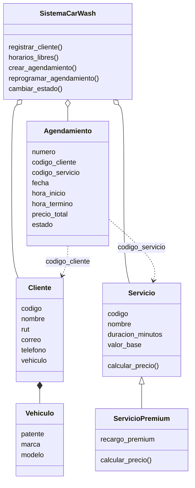

# Clases principales de CarWash

`ServicioPremium` hereda de `Servicio`. Cuando la agenda calcula el valor,
llama a `calcular_precio()`: el servicio normal devuelve el valor base y el
premium suma su recargo. El agendamiento guarda los códigos del cliente y
del servicio para relacionarlos con sus registros.
